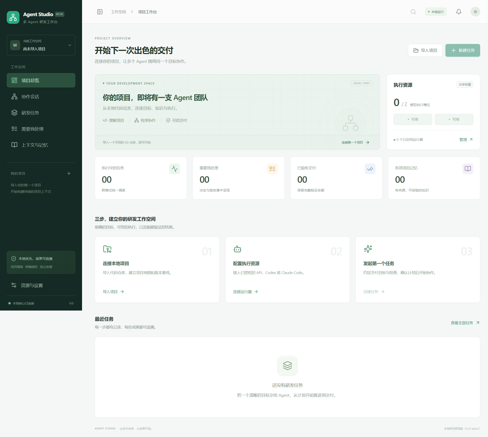

# 多 Agent 智能研发工作台

面向本地 Git 项目的桌面研发工作台。产品规划见[计划书 1.1](./docs/多Agent智能研发工作台计划书.md)，当前实现与验证范围见[实施与验收记录](./docs/implementation-status.md)。

平台使用 Java 21、Spring Boot、SQLite、React、TypeScript 和 Electron。任务在独立工作目录中执行，验证和审查记录绑定代码版本，最终由用户验收。验收操作记录用户决定，不会自动提交、推送或改写原项目。

当前开发版本为 **0.2.0-alpha.3**，稳定预览基线仍为 `v0.1.0`。已提供独立核心/Web、连接已有核心的桌面端、三模式固定阶段，以及接入 API 实现/修复阶段的 MCP 固定动作。本轮补齐 MCP 本地停止确认与容量保留，阻止残留传输被人工核对或业务回执绕过，并验证真实 stdio 父子进程取消；动态副 Agent、原生 CLI MCP 注入、完整备份恢复、自动采纳及三端发布验收仍在后续实施范围。

前后端分离的本机启动、独立构建、配置与客户端退出语义见[独立部署说明](./docs/standalone-deployment.md)。新增需求 F01—F21 及后续节点架构见[架构审查](./docs/research/current-architecture-audit-2026-11-06.md)，本轮来源和范围见[迭代记录](./docs/research/iteration-foundation-2026-11-06.md)。独立入口不代表远程多用户或移动端能力已交付。

## 目录

| 路径 | 用途 |
| --- | --- |
| `core/` | Java 核心、持久任务、调度、工具与运行器 |
| `web/` | 项目、任务、记忆、执行和验收界面 |
| `desktop/` | Electron 窗口与核心进程管理 |
| `tools/` | 启动、构建及验收辅助工具 |
| `docs/` | 产品规划、开发接口和实际验收记录 |

## 使用流程

1. 导入可信任的本地 Git 仓库，检查项目路径、分支、未提交改动和索引状态。
2. 在资源设置中添加运行器及模型配置，执行能力探测。API 密钥仅存在当前核心会话中；重启后需重新输入。
3. 创建任务，填写目标、允许修改范围、验收条件与验证命令，选择协作模式、执行路由、调用预算及验证预留。
4. 检查计划后确认执行。任务运行中可查看实际工具活动、代码差异、调用计数与持久事件，并可暂停或取消。
5. 检查必要验证及独立审查结果。存在未解决问题时保留原始证据，不能把未验证状态视为通过。
6. 验收并导出交付包。将成果采纳回原项目之前，核对原项目是否已发生其他变化。

## 本地开发要求

- Node.js 22 或更高版本，以及 npm。
- Java 21 和 Maven 3.9 或更高版本，用于构建核心。
- Git，供项目识别、隔离任务和差异读取使用。
- 真实 Codex / Claude Code 运行器需要另行安装并登录；API 运行器需要兼容端点和有效凭据。

Windows 开发预览安装包已携带 Java 21 运行时，使用时需要另行安装 Git；源码构建仍要求本机具备上述开发环境。macOS、Linux 与长期运行的验收状态以实施记录为准。

在项目根目录运行：

```powershell
npm run setup
npm run build
npm run start
```

`setup` 准备项目依赖，`build` 构建核心和网页界面，`start` 启动桌面工作台。Windows 也提供 `start.ps1` 启动入口。开发时运行 `npm run dev`。

这些命令的实际验证环境与结果记录在实施记录中；尚未验证的平台不据此视为支持完成。

构建 Windows 安装包使用 `npm run package`，输出为 `release/Agent Workbench Setup <当前版本>.exe`。安装包为未签名开发预览。桌面启动和内置运行时检查使用 `npm run test:desktop`；指定 `WORKBENCH_ELECTRON_PATH` 与 `WORKBENCH_EXPECT_PACKAGED=1` 可检查打包或安装后的程序。



## 核心接口

核心默认只监听 `127.0.0.1:18765`，管理 API 请求需要启动令牌：

```http
Authorization: Bearer <本次启动令牌>
```

开发接口包括项目导入与搜索、任务计划与执行控制、版本差异、证据、事件续读、记忆治理和运行器配置，见[接口约定](./docs/implementation-contract.md)。独立 MCP 模块提供 `/api/mcp/servers` 管理接口与 `/api/mcp/rpc/{projectId}` 只读服务端；通过 `/api/mcp/access` 签发或撤销项目专属会话令牌，该令牌只能访问指定项目的只读 RPC。MCP 尚未自动接入 Agent 工具回路。请勿把启动令牌或 API 密钥提交到仓库。

## 自动化验收

构建完成并确保 `JAVA_HOME` 指向 Java 21 后，可自动启动独立测试核心并执行 22 项集成检查：

```powershell
node tools/ci-smoke.mjs
```

脚本创建独立数据目录、临时 Git 样例和本机模型测试端点，结束后关闭测试核心，不会使用外部供应商，也不需要真实 API 密钥。测试报告保留在终端显示的临时目录，并复制到 `docs/qa/smoke-<platform>.json`。直接执行 smoke 脚本时可通过 `WORKBENCH_REPORT_PATH` 指定报告副本位置。报告会去除启动令牌和测试密钥。核心单元及运行器集成测试使用 `npm test`。

也可以连接自行启动的测试核心。此时请使用独立数据目录，避免测试任务出现在日常工作台中。

PowerShell 示例：

```powershell
$env:WORKBENCH_URL = 'http://127.0.0.1:18765'
$env:WORKBENCH_TOKEN = '<测试核心的启动令牌>'
node tools/smoke-test.mjs
```

此测试确认 HTTP 接口、Java 工具回路、Git 隔离、验证、审查和验收状态的协作行为。外部模型、原生 CLI、安装包以及三端兼容性仍需分别进行真实验证。测试报告和未覆盖事项记录在[实施与验收记录](./docs/implementation-status.md)。

## 开发约束

保留已有 Java 注释原文与格式。新增 Java 文档注释使用多行 `/**`、` * 内容`、` */`，并保留字段、方法和关键逻辑的必要说明。计划主稿与阅读版由原有文档工具维护，不从代码实现反向降低计划验收要求。

## 许可证

本项目采用 [MIT License](./LICENSE)。
