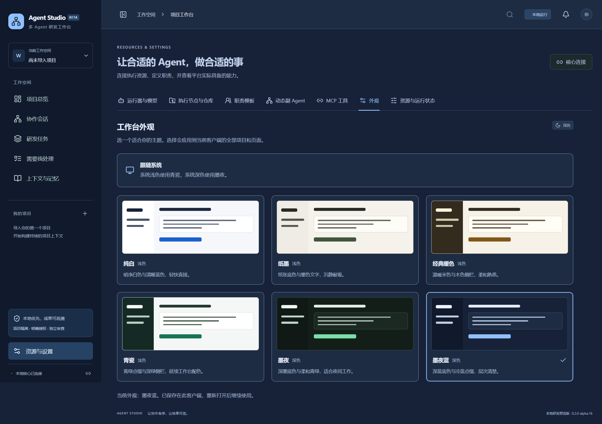

# 多 Agent 智能研发工作台

面向本地 Git 项目的桌面研发工作台。产品规划见[计划书 1.1](./docs/多Agent智能研发工作台计划书.md)，当前实现与验证范围见[实施与验收记录](./docs/implementation-status.md)。

平台使用 Java 21、Spring Boot、SQLite、React、TypeScript 和 Electron。任务在独立工作目录中执行，验证和审查记录绑定代码版本，最终由用户验收。验收操作记录用户决定，不会自动提交、推送或改写原项目。

当前开发版本为 **0.2.0-alpha.28**。Workflow 在首次模型请求前收到暂停时，按原 Worker 的取消回执结束节点，不制造未知操作；已有模型请求或未确认副作用时仍保留 `UNKNOWN`。原生 CLI 使用结构化终态、独立 stdout 和原进程收尾事实判断结果；中间输出、非零退出冲突、截断或缺少终态保持 `UNKNOWN`，解析结果随原模型会话持久保存，预算不回退。协议与固定开源依据见[原生终态研究](./docs/research/native-cli-receipts-2026-11-21.md)。显式操作系统沙箱请求继续沿用 `NativeSandboxPolicy` 门禁；当前默认策略为 `UNAVAILABLE`，真实平台强制器和官方 CLI 混合阶段仍继续实施。

alpha.25 的内部只读 `stage_input` MCP 桥继续限定在原 Workflow Worker 调用，握手和调用重验任务、流程代次、节点尝试、AgentRun、输入准备回执、固定输入、权限、写入归属与原领取；取消、失联、撤销、过期、输入变化或核心重启后旧令牌失效。桥仍只作为私有 Worker 参数传递，真实 Codex/Claude CLI 消费与混合阶段尚未启用。

alpha.25 本机 Windows 清洁核心回归 **673 项（663 通过、10 项条件跳过）**、生产 UI **272/272**、最终 Jar 本机确定性 HTTP 协议检查 **34/34** 均通过；最终 Jar SHA-256 为 `4e75501991b345ce0073a29c447f843b514d5cb99e494481ba1cfb3cad635724`。详细范围、首次失败和剩余原生阶段边界见[实施与验收记录](./docs/implementation-status.md)、[Workflow 协议](./docs/workflow-contract.md)及[alpha.25 本机验收回执](./docs/qa/alpha25-stage-input-win32.json)。真实 Codex/Claude 混合阶段、任务/领取限定桥的原生消费者、跨平台 CI 和完整 M2 仍继续实施。

此前 alpha.23 请求崩溃恢复与根预算边界通过本机完整核心 **613 项、0 失败、10 条件跳过**，实现提交 `13665a5` 三端 CI 成功；历史失败、首次 Windows 失败与成功重跑均保留。子任务准备失联后的 `UNKNOWN` 收尾另经重新编译的 24 项定向回归与打包验证，原 CI Worker 失联根因仍未确定。稳定预览基线仍为 `v0.1.0`。

实际任务现场、模型、文件工具和验证由独立 Java Worker 执行，核心独占 SQLite、预算、授权与团队调度。私有管道交接原操作租约，界面和导出分别保存 Worker PID 与核心 PID；关闭客户端保留在途执行，失联或回执缺失保持 UNKNOWN，不自动启动替代 Worker 或重放。核心重启后按原 PID/出生核验 Worker 和 MCP stdio，分别记录进程覆盖与任务外部效果；已知仍活着或无法核验的进程不能由人工勾选绕过。协议见[独立进程约定](./docs/worker-process-contract.md)与[进程恢复约定](./docs/process-recovery-contract.md)。

“协作会话 → 网页预览”可绑定本机端口、打开多个网页标签，并在桌面完整退出重开后保留登录数据。核心只保存脱敏地址和标签，浏览数据保存在隔离的桌面分区中；支持清理当前站点和重置整个会话存储。独立 Web 明确显示桌面能力提示。端口授权不证明服务进程身份，远程转发与外部 OAuth 尚待分别验收，具体边界见[会话预览约定](./docs/preview-contract.md)。

在“资源与设置 → 外观”选择纯白、纸墨、经典暖色、青瓷、墨夜或墨夜蓝，选择会应用到当前客户端的全部项目和页面。默认跟随系统，浅色使用青瓷、深色使用墨夜；固定选择会跨重新打开保留。浏览器无法保存时，当前窗口仍可切换，并提示未保存。核心离线时也可调整外观，具体来源与验收见[主题研究](./docs/research/themes-2026-11-12.md)。

拖动侧栏边缘可调整宽度，分隔器支持方向键、Shift、Home/End 与 Enter 收起恢复。宽度和收起选择保存在此客户端；缩小窗口保留大窗口选择，存储失败保留本次窗口布局。外观设置可恢复默认布局，具体行为与验收边界见[侧栏布局约定](./docs/sidebar-layout-contract.md)。

任务“代码差异”页按文件树查看变更，显示实际原行/新行、增删高亮、内容版本与固定 Git 基线。读取变化要求刷新，二进制、敏感路径、超限、空文件和仅执行位变化有明确状态；长行在代码区域内滚动，窄窗口上下排列。手动刷新保留仍有变更的选中文件，协议与边界见[逐文件差异约定](./docs/diff-view-contract.md)。原项目逐文件/代码块局部采纳继续实施。

任务“检查点与撤销”页可查看准备、阶段和成功文件工具保存的实际文件边界；任务停止并完成原根收尾后，也可手动保存。选择较早检查点会先列出反向改动和冲突，确认后由新的根执行尝试交给原 Worker 撤销。未参与改动的用户后续文件保留，HEAD、累计预算和旧回执保持；撤销成功后任务暂停，当前现场需要重新验证和审查。归档包含原文件、二进制、完整 index 和暂存对象，交付 ZIP 核对全部引用；回执丢失时保留 UNKNOWN、已观察效果和原日志。具体范围与限额见[检查点与撤销约定](./docs/checkpoint-contract.md)。

任务原自动执行收尾后，可在“终端”页建立实际独立目录中的系统 shell。新页面默认仅查看，显式取得控制后可输入、粘贴和调整尺寸；离开、返回或重载保留原 shell，重读输出不会重发命令。终端以当前系统账户运行，原始输出可能含命令回显并随交付包保存。手动停止后任务暂停，当前修改需要重新验证与审查，累计模型预算和旧证据保留；撤权、失联或丢失回执继续保留 UNKNOWN，禁止自动重放。具体边界见[任务终端协议](./docs/terminal-contract.md)，来源和原失败见[终端研究](./docs/research/terminals-2026-11-16.md)。

浏览器的离线提示会触发本地核心的实际连接核验；本地端点仍可达时可以继续读取。终端在页面返回或读取连接恢复后沿原字节游标继续显示，并回到查看模式，重新操作前需点击接管控制。初始化明确失败时使用“重试连接”，草稿和原选择保留。具体范围与验收见[恢复研究](./docs/research/terminal-recovery-2026-11-18.md)。

alpha.19 生产提交 `eb666f4` 的 Windows、macOS、Linux CI 已通过，三份实际证据 ZIP 的大小和 SHA-256 均核对。核心分别为452、454、454项，UI每端196项；原 Worker 逐文件撤权后的部分效果与 UNKNOWN、实际检查点撤销16项、原协议及发行主题/侧栏/内置JRE均验收。条件跳过、原三条CI失败、Windows/POSIX用例展开及验证边界见[三平台正式成功回执](./docs/qa/alpha19-per-file-boundary-ci-success-receipt.json)。

计划确认与显式继续同事务保存根执行尝试和待派发动作。未领取动作可跨重启保留原编号，门禁满足后领取一次；已领取后缺少结果保持 UNKNOWN，核对后继续建立新尝试并沿用累计预算。“任务派发”页和 ZIP 保存完整历史，执行结束与人工验收分别记录。边界见[根派发协议](./docs/task-dispatch-contract.md)。

创建任务可从实际本地或远程分支选择提交，以独立 clone 或锁定的 detached Git worktree 执行。计划保存所选 SHA、源文件与 index 快照，排队期间源变化会要求重新确认；完整 READY 现场在核对原目录、关联、归属和内容后可复用，原未知尝试与规则保留在历史和 ZIP 中。SQLite schema 为 11，API 与 Worker 帧协议仍为 1；旧核心不能打开新库。协议见[启动现场约定](./docs/workspace-selection-contract.md)。

原 Worker 从准备到根收尾持有实际文件锁，写入意图与根领取、授予与操作 ACK 分别同事务保存。模型容量释放和客户端退出保留根保护；丢失回执保持原 UNKNOWN，核对原进程及效果后释放保护，下一次恢复建立新的写入编号。Worker 页、请求/MCP 来源和 ZIP 可查看完整记录，边界见[根写入保护协议](./docs/workspace-write-contract.md)。当前目录执行、跨核心共享现场协调与完整 worktree 归档恢复继续实施。

API Agent 覆盖已有文本前须完整读取并提供原 `readVersion`；删除须提供当前读取或检查回执。用户在读取后修改文件时，旧操作被拒绝，重新读取后才可决定修改；未解决冲突进入等待输入。任务详情“文件操作”页显示版本、冲突和原请求来源，ZIP 包含完整根/副 Agent 历史。协议及外部写入窗口见[文件版本约定](./docs/file-version-contract.md)。

任务可固定一个已有 Workflow 版本，按声明依赖、输入、权限和路由执行真实 DAG 节点。每个节点在独立现场留下原 Worker 和模型来源证据，成功成果按版本检查后才整合；暂停恢复只复用完整成功记录，不重发原请求。可从已有任务生成只读候选，核验原模型输出并在发布前编辑；只有明确发布才产生新 Workflow 版本，版本记录也包含在任务导出中。使用和协议边界见[Workflow 协议](./docs/workflow-contract.md)，各版本实际验收范围见实施记录。

Windows 原 PID 被受限进程复用、Java 句柄无法读取当前出生时间时，核心通过只读系统快照补充出生信息，核对后保留原身份和新的出生。快照无法核验时继续显示未知；请求停止仍逐项检查原 Java 句柄的出生时间。具体边界见[进程恢复约定](./docs/process-recovery-contract.md)。

API 任务可按创建时固定的定义、模型路由和限制实际委派副 Agent。副任务在独立 Git 副本中执行，父 Agent 等待时释放模型容量，核对依赖成果后采纳文件；全部后代共用根模型和 MCP 预算。设置页可编辑版本化定义，任务页显示真实父子状态、权限、依赖、消息、原模型/工具来源和采纳回执。逐轮请求追踪、会话搜索、独立验证/审查及人工验收继续保留；未知效果不自动重放。协议见[动态团队约定](./docs/team-contract.md)、[模型请求协议](./docs/model-request-contract.md)及[Agent 运行协议](./docs/agent-run-contract.md)。远程队列与配对、完整操作系统历史树与资源隔离、项目会话级与远程终端、跨核心动态 Workflow 编排、Token 趋势、原生 CLI 委派、完整备份恢复与正式发布仍在实施。

前后端分离的本机启动、独立构建、配置与客户端退出语义见[独立部署说明](./docs/standalone-deployment.md)。新增需求 F01—F21 及后续节点架构见[架构审查](./docs/research/current-architecture-audit-2026-11-06.md)，本轮来源和范围见[迭代记录](./docs/research/iteration-foundation-2026-11-06.md)。独立入口不代表远程多用户或移动端能力已交付。

## 目录

| 路径 | 用途 |
| --- | --- |
| `core/` | Java 核心、持久任务、调度、工具与运行器 |
| `web/` | 项目、任务、记忆、执行和验收界面 |
| `desktop/` | Electron 窗口与核心进程管理 |
| `tools/` | 启动、构建及验收辅助工具 |
| `docs/` | 产品规划、开发接口和实际验收记录 |

## 使用流程

1. 导入可信任的本地 Git 仓库，检查项目路径、分支、未提交改动和索引状态；导入时建立本机节点与仓库绑定，也可在设置中添加该项目的其他本机 Git 目录。
2. 在资源设置中添加运行器及模型配置，执行能力探测。API 密钥仅存在当前核心会话中；重启后需重新输入。
3. 在“协作会话”中创建或打开会话，保存背景笔记并创建任务；也可直接新建任务，系统自动建立会话。填写目标、允许修改范围、验收条件与验证命令，选择仓库绑定、启动提交、clone/worktree、协作模式、执行路由、调用预算及验证预留。带入未提交修改时使用当前 HEAD，并检查展示的文件和暂存区快照；源变化后刷新并重新确认。API 任务可选择动态副 Agent，核对定义版本、额外数据发送路由和根限制。笔记不会自动启动模型或修改在途任务目标。
4. 检查计划后确认执行。任务运行中可查看派发历史、等待条件、团队依赖、实际权限和通信，以及 Worker 租约、工具活动、代码差异、请求来源、调用计数与持久事件，并可暂停或取消。节点或仓库配置变化后，核对未知效果并更新执行授权再恢复。核心重启后若有旧进程待核验，先在资源设置 → 执行节点与仓库检查原进程及清单覆盖，再到 UNKNOWN 任务另行核对文件与外部效果；原未领取动作在门禁满足后自动继续排队检查。
5. 检查必要验证及独立审查结果。存在未解决问题时保留原始证据，不能把未验证状态视为通过。
6. 验收并导出交付包。将成果采纳回原项目之前，核对原项目是否已发生其他变化。

## 本地开发要求

- Node.js 22 或更高版本，以及 npm。
- Java 21 和 Maven 3.9 或更高版本，用于构建核心。
- Git，供项目识别、隔离任务和差异读取使用。
- 真实 Codex / Claude Code 运行器需要另行安装并登录；API 运行器需要兼容端点和有效凭据。

Windows 开发预览安装包已携带 Java 21 运行时，使用时需要另行安装 Git；源码构建仍要求本机具备上述开发环境。macOS、Linux 与长期运行的验收状态以实施记录为准。

在项目根目录运行：

```powershell
npm run setup
npm run build
npm run start
```

`setup` 准备项目依赖，`build` 构建核心和网页界面，`start` 启动桌面工作台。Windows 也提供 `start.ps1` 启动入口。开发时运行 `npm run dev`。

`npm run verify:core` 执行核心的 `mvn clean verify`，重新编译后运行完整核心测试并打包。`clean` 会删除 `core/target`；若其中保存了待分析的失败现场、日志或旧 class，请先归档。做过源码负对照或恢复文件时间后，不能只凭增量构建或源码摘要断言已执行新实现，应核对实际重编译及 JAR 内 class。

这些命令的实际验证环境与结果记录在实施记录中；尚未验证的平台不据此视为支持完成。

构建 Windows 安装包使用 `npm run package`，输出为 `release/Agent Workbench Setup <当前版本>.exe`。安装包为未签名开发预览。桌面启动和内置运行时检查使用 `npm run test:desktop`；指定 `WORKBENCH_ELECTRON_PATH` 与 `WORKBENCH_EXPECT_PACKAGED=1` 可检查打包或安装后的程序。

`npm run test:themes:web` 检查实际生产 Web 在入口加载前应用主题，以及系统变化和存储失败。`npm run test:themes:desktop` 用同一独立用户目录启动桌面两次，检查六主题、渲染器重载和完整退出后的偏好恢复；`npm run test:themes:packaged` 对当前系统发行目录执行同样检查。两次启动分别核验原桌面、核心和 Worker 的停止，发行版同时禁用外部 Java 配置。

`npm run test:layout:desktop` 在同一真实启动中执行原六主题 12 项与独立侧栏检查，覆盖鼠标、键盘、拖动中重载、完整退出重开和最小原生窗口；`npm run test:layout:packaged` 对当前发行目录执行同样验收并禁用外部 Java。侧栏报告另保存为 `docs/qa/sidebar-<desktop|packaged>-<platform>.json`。

`npm run test:diff-view` 使用当前最终 Jar、原独立 Worker、真实 clone/worktree 和生产 Web，检查文件修改、原/新行号、旧接口与交付补丁、实际二进制/排除/大小/行限制、版本及 HEAD 冲突、窄屏和显式刷新，并独立核验原 PID/出生停止。实际集成与浏览器协议夹具证据分别保存。

`npm run test:checkpoints` 使用普通最终 Jar、原 Worker 和生产 Web，验证 clone/worktree 的实际文件/index保存、工具请求来源、稳定历史分页、过期预览零写入、撤销与用户后续文件保全、重新验证状态和完整引用 ZIP。两处 SQLite 回执故障分别保留原 APPLIED/ACK/UNKNOWN，重启核对原身份并检查零重放；本机确定性模型、故障注入源码、编译类和完整现场按每次独立运行保存。

`npm run test:previews` 检查端口与导航策略、窄 IPC、配置同步和清理失败边界。`npm run test:previews:native` 启动实际开发桌面、核心与 Worker，用本地 HTTP 登录夹具检查持久 Cookie、项目/会话隔离、多标签、弹窗暂停、站点清理、代次账本与撤权。完成 `npm run package:prepared` 后，`npm run test:previews:packaged` 核对包内 Jar、JRE 与全部桌面/Web 字节，移除 PATH 中的外部 Java/Node 后对实际发行程序运行相同九组检查。两个原生入口在 Linux 均需虚拟显示；安装器生命周期、外部 OAuth 与远程转发分别验收。



上图来自 alpha.16 的实际 Windows 桌面主题验收，也可查看[纯白外观](./docs/qa/themes-light-win32.png)。

## 核心接口

核心默认只监听 `127.0.0.1:18765`，管理 API 请求需要启动令牌：

```http
Authorization: Bearer <本次启动令牌>
```

开发接口包括项目导入与搜索、会话、任务计划与执行控制、版本差异、证据、事件续读、记忆治理和运行器配置，见[接口约定](./docs/implementation-contract.md)与[会话约定](./docs/session-contract.md)。独立 MCP 模块提供 `/api/mcp/servers` 管理接口与 `/api/mcp/rpc/{projectId}` 只读服务端；通过 `/api/mcp/access` 签发或撤销项目专属会话令牌，该令牌只能访问指定项目的只读 RPC。API 任务可使用确认计划中的 MCP 固定动作；原生 CLI 尚未注入 MCP。请勿把启动令牌或 API 密钥提交到仓库。

## 自动化验收

构建完成并确保 `JAVA_HOME` 指向 Java 21 后，可自动启动独立测试核心并执行 29 项集成检查：

```powershell
node tools/ci-smoke.mjs
```

脚本创建独立数据目录、临时 Git 样例和本机模型测试端点，结束后关闭测试核心，不会使用外部供应商，也不需要真实 API 密钥。测试报告保留在终端显示的临时目录，并复制到 `docs/qa/smoke-<platform>.json`。直接执行 smoke 脚本时可通过 `WORKBENCH_REPORT_PATH` 指定报告副本位置。报告会去除启动令牌和测试密钥。核心单元及运行器集成测试使用 `npm test`。

也可以连接自行启动的测试核心。此时请使用独立数据目录，避免测试任务出现在日常工作台中。

PowerShell 示例：

```powershell
$env:WORKBENCH_URL = 'http://127.0.0.1:18765'
$env:WORKBENCH_TOKEN = '<测试核心的启动令牌>'
node tools/smoke-test.mjs
```

此测试确认 HTTP 接口、Java 工具回路、Git 隔离、真实动态委派/依赖/采纳、根预算、MCP 原来源、交付 ZIP、验证、审查和验收行为。外部模型、原生 CLI、安装包以及三端兼容性仍需分别进行真实验证。测试报告和未覆盖事项记录在[实施与验收记录](./docs/implementation-status.md)。

`npm run test:recovery` 另行验证真实核心崩溃、原 MCP 存活、同目录重启、进程门禁、生产界面、预算/请求保全和零重放。它使用本机确定性模型与 stdio 夹具，完整日志及清理前失败事实保存于每次独立运行目录；API 报告与截图按平台保存。该脚本需要已构建的核心/Web 和 Playwright 浏览器，不使用日常数据目录。

`npm run test:dispatch` 验证最终 Jar 的根队列事务、未领取撤回、原编号跨重启领取一次、领取后崩溃 UNKNOWN 与核对后的新尝试。未领取窗口由外部受控执行器夹具建立，其他持久化、Worker、HTTP、生产重开和界面均使用实际路径；每次运行保留独立证据目录。它同样使用专属样例和确定性模型，不调用外部付费供应商。

`npm run test:workspaces` 验证实际分支选择、固定 SHA 的 clone/worktree、原 HEAD/index/config/refs 保全、过期选择的生产界面刷新、归属变化拒绝和 READY 回执恢复。外部队列门建立未领取窗口，SQLite 故障发生在原 Worker 保存 READY 并 ACK 之后；重开使用普通生产 Jar。脚本保留原源码、编译类、两次尝试、停止身份和 ZIP，人工 PREPARED 故障窗口单独标记。它需要已构建的核心/Web 和 Playwright 浏览器。

`npm run test:workspace-writes` 验证普通最终 Jar 的实际根文件锁、第二 JVM 竞争、文件工具写入、Node 验证、READY 复用，以及 clone/worktree 的授予与释放回执数据库故障。生产 Web、原 UNKNOWN/新尝试、预算、两尝试 ZIP 和原 PID/出生停止事实分别保存；该入口需要已构建核心/Web 和 Playwright 浏览器，结果按平台记录。

`npm run test:file-versions` 使用普通最终 Jar 与原独立 Worker，验证相同字节大小且恢复 mtime 的用户改动、旧覆盖/删除拒绝、重新读取后的恢复、未解决冲突等待和原请求/参数摘要。实际八条文件回执与明确标记的旧日志夹具一起验证超过单页的完整历史/ZIP、引号和反斜杠凭据脱敏及原进程停止；样例和原始事实保存在独立运行目录。

完成上述验收和 `npm run package:prepared` 后，`npm run test:bundled-writer` 使用实际发行目录中的内置 Java，加载已核对的最终核心和一次编译夹具，验证原生文件身份、锁授予、借用期间拒绝提前释放、正常释放及原探针退出。Windows 同时核验实际系统进程快照与原探针出生。报告保存包内核心、Java、JNA 和许可摘要；该入口复用已有夹具，不需要内置编译器。

## 开发约束

保留已有 Java 注释原文与格式。新增 Java 文档注释使用多行 `/**`、` * 内容`、` */`，并保留字段、方法和关键逻辑的必要说明。计划主稿与阅读版由原有文档工具维护，不从代码实现反向降低计划验收要求。

## 许可证

本项目采用 [MIT License](./LICENSE)。

alpha.14 使用原字节的 JNA 5.17.0 依赖，选择 Apache-2.0 许可路径；固定源码、产物摘要、包内许可和 JDK 打开模式见[第三方依赖记录](./docs/third-party-dependencies.md)。

文档提交 `e06f770` 的 [run 43851324554](https://github.com/lihe-he/multi-agent/actions/runs/43851324554) 已终态失败：macOS、Linux 的核心454项、UI196项及实际发行核验通过；Windows核心452项、UI196项、真实差异14项、检查点16项与恢复11项通过，在队列 held 根的首次模型调用处保留 UNKNOWN。原请求9ms后记录 ExecutionException，预算和派发各一次，未到强杀核心步骤。三份实际证据ZIP大小与GitHub SHA-256均核对；206份接受产品源码与先前三端成功生产提交完全一致，底层传输原因及原现场缺口仍为UNKNOWN。见[本次独立失败回执](./docs/qa/alpha19-documentation-ci-original-queue-failure-receipt.json)。
